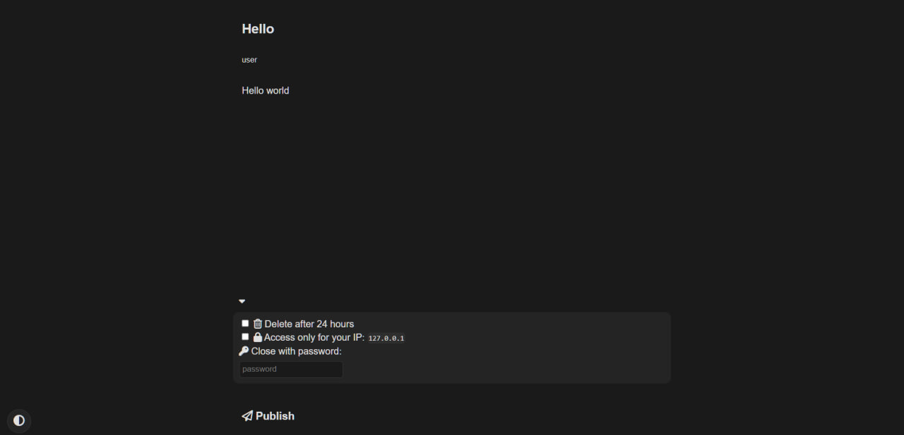

# twrite

A lightweight, self-hosted service for writing and sharing text publications, inspired by [Telegra.ph](https://telegra.ph/). No account is required to publish.

## Features

- **Rich-text editor:** bold, italic, underline, strikethrough, links, code blocks, font sizes, and semantic heading styles (Heading 1–3 and paragraph).
- **Tables:** insert editable tables with a visual, cursor-driven **8-column × 12-row** size picker.
- **Minimal formatting UI:** expand or collapse the toolbar using the icon at the right end of the divider between author and content. It stays open until you close it or press Esc.
- **Images:** image URLs in the text can be converted into inline images.
- **Publication options:** optional password protection, author-IP restriction, and deletion after 24 hours.
- **Editing:** creators can edit their publications using a browser owner cookie. Keep that cookie if you want to retain editing access.
- **Drafts and preview:** automatic per-tab draft saving, restoration, and publication preview.
- **Writing experience:** word and character counts, estimated reading time, and focus mode.
- **Themes:** ten light/dark color themes, including Paper, Sepia, Rose, Ocean, Forest, Midnight, OLED Black, Graphite, Deep Ocean, and Evergreen.
- **Sharing:** unique random publication URLs and a copy-link control.
- **Automatic cleanup:** publications expire after one year; posts marked for early deletion expire after 24 hours.

## Requirements

- PHP **7.4+** with **mysqli**, **mbstring**, and **DOM/XML** extensions
- MySQL 8.0 (the database version used by the project)
- Nginx or Apache with URL rewriting and PHP support
- HTTPS recommended, especially for session and owner cookies

## Installation

1. Clone the repository into your web directory.
2. Import `twrite.sql` into MySQL.
3. Copy `.env.example` to `.env` and configure the database connection.
4. Configure the web server to route publication URLs through `index.php` (see your Nginx/Apache configuration).
5. **Block direct HTTP access to `.env` and other hidden/private files.** For Nginx, adapt `nginx-security.conf` to the active server block; for Apache, check that `.htaccess` is applied. Verify that requesting `/.env` returns HTTP 403 or 404.
6. Set appropriate file permissions, enable HTTPS, and test creating, viewing, and editing a publication.

### Configuration

```dotenv
APP_NAME=twrite
DB_HOST=127.0.0.1
DB_PORT=3306
DB_USER=twrite
DB_PASSWORD=change-me
DB_NAME=twrite
```

- `APP_NAME` controls the project name displayed in the page titles and header. The logo mark automatically uses its **first Unicode character**. If omitted, the name defaults to `twrite`.
- `DB_*` settings configure the MySQL connection.

Never commit the real `.env` file. It is excluded by `.gitignore`, but **web-server access controls are still required** if the file lives inside the document root.

## Using the editor

Write a title, optionally specify an author, then enter the publication text below the divider.

Click the **formatting icon at the right end of the divider** to reveal the toolbar. Select text or place the caret in the editor to apply formatting.

To insert a table, click the table icon, **hover over the grid** to choose columns and rows, then click the desired size. On touch devices, tap a cell to choose the dimensions. The first row is formatted as table headers.

Use **Publication settings** to configure optional restrictions and expiration before publishing. After publication, copy the link to share it. Editing requires the original browser's owner cookie.

## Security notes

- User-supplied HTML is sanitized on the server using an allowlist; only supported formatting, links, images, headings, and table elements are retained.
- Database queries use prepared statements; forms include CSRF protection.
- Publication identifiers are generated using cryptographically secure random bytes.
- Publication throttling and password-attempt limits are currently **session-based**, not a substitute for web-server or edge-level rate limiting.
- Content Security Policy is currently **report-only**; do not assume a strict enforced CSP.
- IP-restricted publications use the server's observed client address. Behind a reverse proxy, configure trusted client-IP forwarding carefully before relying on this restriction.

## Screenshot


