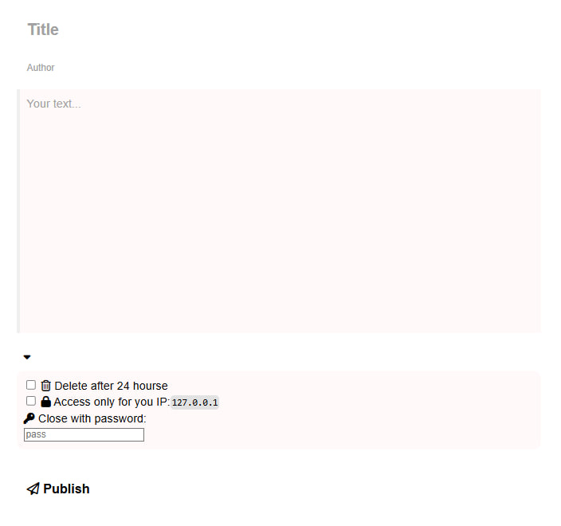

# twrite
Simple service for publishing text posts. [Telegra.ph](https://telegra.ph/) analogue.

# Requirements
- PHP 7.2+
- MySQL 8.0
- Nginx\Apache 

# Settings

Import `twrite/twrite.sql` into MySQL.

Copy `twrite/.env.example` to `twrite/.env` and configure `DB_HOST`, `DB_PORT`, `DB_USER`, `DB_PASSWORD`, and `DB_NAME`. The application reads this file at startup. Do not commit `.env`; it is excluded by `.gitignore`.

For Nginx, add the deny rule from `twrite/nginx-security.conf` to your active server block (and reload Nginx). Apache uses `twrite/.htaccess` if overrides are enabled. Prefer storing `.env` outside the public web root when deploying; if it remains in the document root, verify direct HTTP requests to `/.env` return 403/404. Restrict file permissions to the PHP-FPM user.

In file index.php enter name project:
```php
$name_project = "twrite"; //name
```

# Details
1. All entries will be deleted after a year.
2. You can set the entry to be deleted after 24 hours.
3. You can set the entry to be closed with a password.
4. You can set access to the entry only by IP to the user who creates the entry.
5. You can edit entries after publication.
6. Normal text formatting is available.
7. You can insert images as links and they will be displayed in the entries.

---
The result will be something like this:


